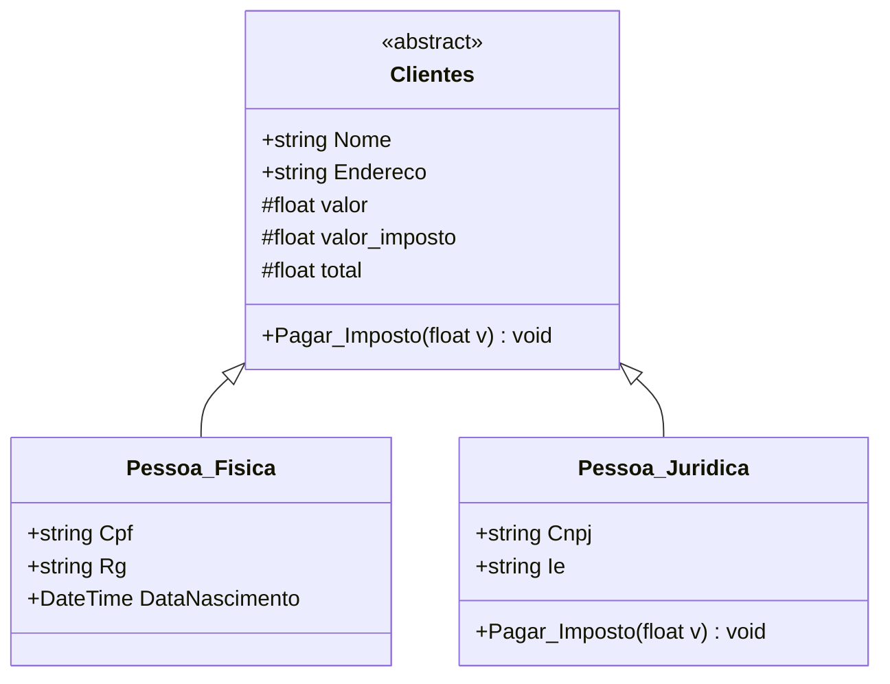

# ClientLab: Sistema de Controle de Clientes (C#)

Atividade **SA2 – Desenvolvimento de sistema de controle de clientes** (Formação Full Stack, SENAI-DF).

Sistema de console desenvolvido pela **Troppo** para a **ClientLab**, que substitui o registro de clientes em papel. Ele cadastra **pessoas físicas** e **jurídicas**, calcula o **pagamento de impostos** e **grava os registros em arquivo**.

## ✅ Funcionalidades

| Opção | Funcionalidade |
|---|---|
| 1 | Cadastrar Pessoa Física (nome, endereço, CPF, RG e data de nascimento) |
| 2 | Cadastrar Pessoa Jurídica (nome, endereço, CNPJ e Inscrição Estadual) |
| 3 | Listar clientes cadastrados |
| 4 | Pagar imposto (Pessoa Física: **10%**, Pessoa Jurídica: **20%**) |
| 5 | Excluir cliente (com confirmação) |
| 0 | Sair |

Os dados ficam salvos no arquivo **`clientes.txt`** e são carregados automaticamente quando o sistema abre.

## 🧩 Diagrama de classes



## 🧠 Conceitos aplicados

### Linguagem C#
- **Entrada e saída de dados:** `Console.ReadLine()` e `Console.WriteLine()`
- **Declaração de variáveis:** `string`, `float`, `int`, `DateTime`, `bool`
- **Operadores aritméticos:** cálculo do imposto (`valor * PercentualImposto / 100`) e do total
- **Estruturas condicionais e de repetição:** `if/else`, `switch` do menu, `while` e `for`
- **Operadores relacionais e lógicos:** `<=`, `>`, `!=`, `==`, `&&`, `||`, `!`

### Programação Orientada a Objetos
- **Abstração:** `Clientes` é uma classe abstrata com o que é comum a todos os clientes
- **Classes, propriedades e métodos:** `Pessoa_Fisica`, `Pessoa_Juridica`, `Nome`, `Cpf`, `Pagar_Imposto()`
- **Herança:** `Pessoa_Fisica` e `Pessoa_Juridica` herdam de `Clientes`
- **Polimorfismo:** `Pessoa_Juridica` sobrescreve (`override`) `Pagar_Imposto()` com 20%, e cada classe sobrescreve `Exibir()`
- **Encapsulamento:** campos `private`/`protected`, com validação dentro das propriedades (`set`)

## 🛡️ Tratamento de valores não permitidos

| Campo | Regra |
|---|---|
| Nome, endereço | Obrigatórios, até 100 caracteres |
| CPF | 11 números, dígitos verificadores válidos, sem repetir cadastro |
| CNPJ | 14 números, dígitos verificadores válidos, sem repetir cadastro |
| RG | Entre 5 e 14 números |
| Inscrição Estadual | Entre 8 e 14 números ou `ISENTO` |
| Data de nascimento | Formato dd/mm/aaaa, data existente, não pode ser no futuro |
| Valor do imposto | Número maior que zero (aceita `1500,50`, `1.500,50` ou `1500.50`) |
| Menu | Apenas opções de 0 a 5 |

Quando o usuário digita um valor inválido, o sistema mostra o erro e pede de novo (até 3 tentativas).

## 📂 Estrutura

```
ControleClientes/
├── Program.cs          # menu e interação com o usuário
├── Clientes.cs         # classe base (abstrata)
├── Pessoa_Fisica.cs    # herda de Clientes
├── Pessoa_Juridica.cs  # herda de Clientes e sobrescreve Pagar_Imposto
├── Validacao.cs        # regras de validação (CPF, CNPJ, datas, valores)
└── Arquivo.cs          # gravação e leitura do clientes.txt
```

## ▶️ Como executar

Pré-requisito: [.NET SDK 8](https://dotnet.microsoft.com/download)

```bash
cd ControleClientes
dotnet run
```

Ou abra a pasta no **Visual Studio** / **VS Code** e execute o projeto.

## 👩‍💻 Autora
Valerya Dias · [GitHub](https://github.com/valeryadb) · [LinkedIn](https://linkedin.com/in/valerya-dias)
